<picture>
  <source media="(prefers-color-scheme: dark)" srcset="docs/brand/banner-dark.svg">
  <source media="(prefers-color-scheme: light)" srcset="docs/brand/banner-light.svg">
  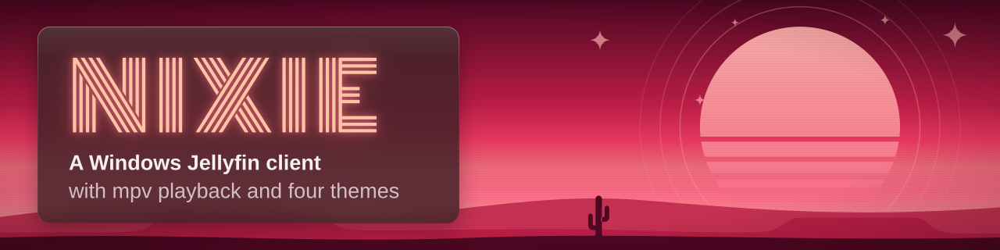
</picture>

<p>
  <a href="https://github.com/mbustos27/nixie/releases/latest"></a>
  <a href="https://github.com/mbustos27/nixie/blob/main/LICENSE"></a>
  <a href="https://github.com/mbustos27/nixie#download"></a>
</p>

**Nixie is a Windows app for the Jellyfin server you use: browse in four glassy themes, and play in mpv in its own window.**

## Download

**Windows 10 or 11 (x64).** The [latest release](https://github.com/mbustos27/nixie/releases/latest) has two files:

- **`Nixie-<version>-win-x64.msi`** installs Nixie for your Windows user, with no administrator rights, and adds it
  to the Start menu. Settings → Apps uninstalls it.
- **`Nixie-<version>-win-x64.zip`** is portable: unzip it anywhere and run `Nixie.exe` at the top of the folder.

Nothing else needs installing: .NET, the playback backend and libmpv are inside. Nixie isn't code-signed, so Windows
SmartScreen asks the first time (**More info → Run anyway**). Your settings and data go to `%LOCALAPPDATA%\Nixie`.
What's new: [CHANGELOG.md](CHANGELOG.md).

## The four themes

<table>
  <tr>
    <td width="50%">
      <a href="docs/screenshots/home-drive-in.webp">
        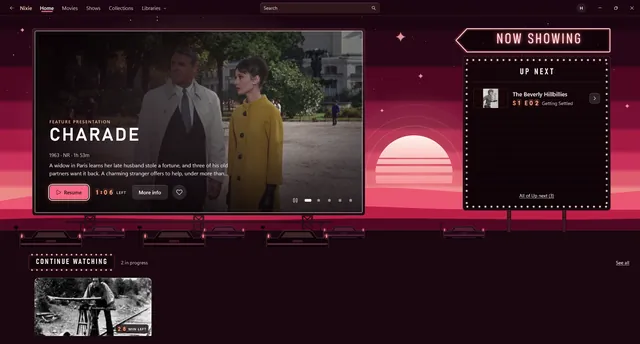
      </a><br><b>Drive-in</b>, the default
    </td>
    <td width="50%">
      <a href="docs/screenshots/home-cinematic.webp">
        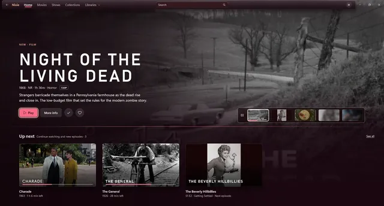
      </a><br><b>Cinematic</b>
    </td>
  </tr>
  <tr>
    <td width="50%">
      <a href="docs/screenshots/home-editorial.webp">
        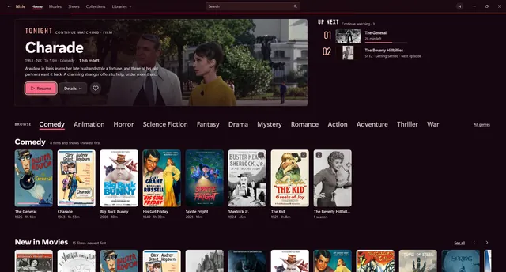
      </a><br><b>Editorial</b>
    </td>
    <td width="50%">
      <a href="docs/screenshots/home-classic.webp">
        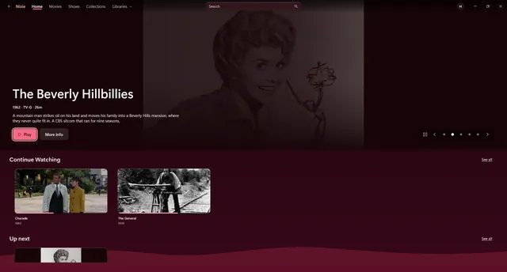
      </a><br><b>Classic</b>
    </td>
  </tr>
</table>

## Why Nixie

- **Four themes, switched at once.** Drive-in (nixie-tube numbers and marquee boards at dusk), Cinematic, Editorial and
  Classic each lay out Home, the item pages and the player's controls their own way. Your place is kept.
- **mpv inside the window.** jellyfin-mpv-shim's engine chooses direct play or a transcode, picks the tracks, shows
  trickplay, and reports to the server as one session.
- **Skips that learn.** Skip intro and credits, "Skip this every episode?" when a show repeats a part, and online intro
  lookups if you turn them on.
- **Collections made for you.** The server's collections and playlists, and Nixie's own, made from your libraries on
  your PC: franchises, keywords and awards, "Acclaimed, not seen yet" and "Under 90 minutes". A library's filters add
  its decades, genre mixes and countries.
- **A TV diary.** Episodes are logged when you finish them, with half-star ratings and reviews, kept on your PC.
- **Keyboard, mouse and Narrator.** Shortcuts everywhere (press **?** for the list), back and forward on mouse buttons
  4 and 5, and every card and button read by name.
- **Private by default.** No account, analytics or telemetry. Online lookups stay off until you turn them on.

Everything it does: [docs/FEATURES.md](docs/FEATURES.md). Every key: [docs/SHORTCUTS.md](docs/SHORTCUTS.md).

## More screenshots

<table>
  <tr>
    <td width="50%">
      <a href="docs/screenshots/movie.webp">
        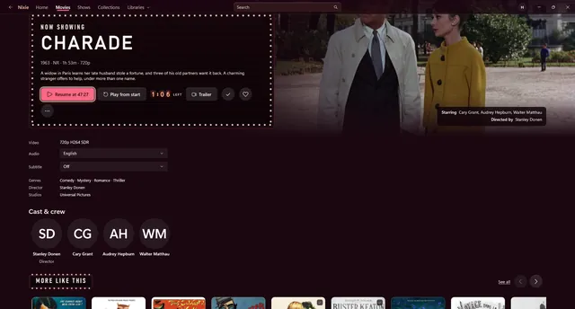
      </a><br>A film's page
    </td>
    <td width="50%">
      <a href="docs/screenshots/series.webp">
        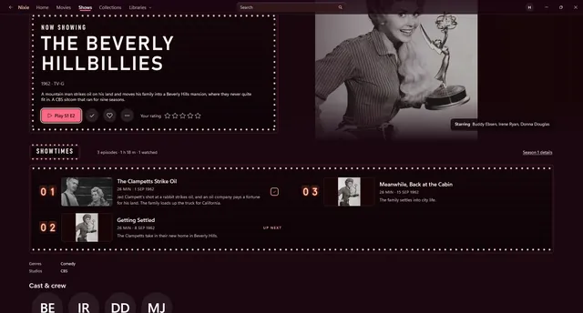
      </a><br>A series
    </td>
  </tr>
  <tr>
    <td width="50%">
      <a href="docs/screenshots/player-stats.webp">
        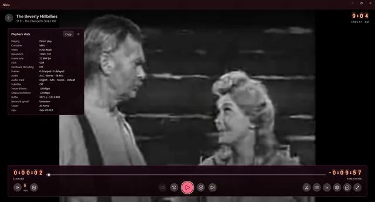
      </a><br>The player, with Playback stats
    </td>
    <td width="50%">
      <a href="docs/screenshots/skip-question.webp">
        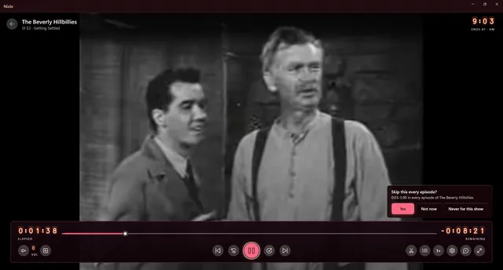
      </a><br>"Skip this every episode?"
    </td>
  </tr>
  <tr>
    <td width="50%">
      <a href="docs/screenshots/collections.webp">
        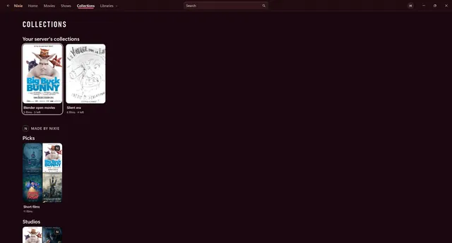
      </a><br>Collections
    </td>
    <td width="50%">
      <a href="docs/screenshots/settings-lists.webp">
        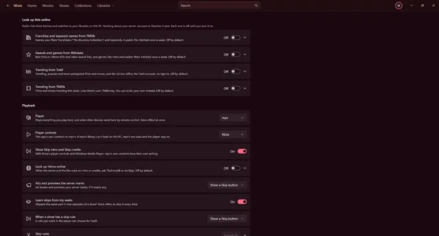
      </a><br>Settings: Look up lists online
    </td>
  </tr>
</table>

Taken off-screen by [tools/ui-harness/gallery.ps1](tools/ui-harness/gallery.ps1) against a test server with
public-domain and Creative Commons films (credits below).

## Outside services

What Nixie sends to GitHub for update checks, to YouTube for trailers, and to Trakt, TMDB and the other outside
sources (each off until you turn it on) is in [PRIVACY.md](PRIVACY.md).

Nixie uses Trakt but is not endorsed or certified by Trakt.

Nixie uses TMDB and the TMDB APIs but is not endorsed, certified, or otherwise approved by TMDB.

## Build from source

You need Windows 10 or 11 (x64), the .NET 10 SDK and Python 3.14:

```powershell
winget install Microsoft.DotNet.SDK.10
winget install Python.Python.3.14
```

Then, in the repository folder:

```powershell
py -3.14 -m venv backend\.venv
backend\.venv\Scripts\pip install -e backend[all]
.\run-dev.ps1            # build and launch
```

To play video, a source build needs **one** of these:

- **libmpv**, for Nixie's own player controls (the default). The quickest way is to copy the release zip's
  `app\libmpv\` folder into `vendor\libmpv\msys2-20261116-mpv-0.42.0-2\`. To build that folder yourself with MSYS2,
  see [vendor/libmpv/VENDORED.md](vendor/libmpv/VENDORED.md).
- **mpv**, for mpv's own controls: `winget install mpv-player.mpv-CI.MSVC`. Without libmpv, Nixie switches to these
  controls by itself and says so.

`.\run-dev.ps1 -SelfTest` plays mpv's test pattern inside the player page, with no server needed.

Settings, logs and the journal go to `%LOCALAPPDATA%\Nixie`. For a separate data folder, start it with
`Nixie.exe --data-dir <folder>`.

## Development

- [docs/BRIDGE.md](docs/BRIDGE.md): the protocol between the UI and the backend. This is the contract both sides are
  tested against.
- [docs/UPSTREAM.md](docs/UPSTREAM.md): the upstream commits this is built from, and how to pull updates.
- [docs/KNOWN-ISSUES.md](docs/KNOWN-ISSUES.md): what is open, accepted or not yet verified.
- [docs/JOURNAL.md](docs/JOURNAL.md): the TV journal's design.
- [docs/design/DESIGN.md](docs/design/DESIGN.md): the glass design rules (tokens, glass modes, motion).
- [docs/brand/README.md](docs/brand/README.md): the banner, the social preview and the palette.
- [docs/DESIGN-RULES.md](docs/DESIGN-RULES.md): what every change and bug hunt looks for (speed on big servers,
  standby, device facts, the way up from any page).
- [docs/SHORTCUTS.md](docs/SHORTCUTS.md): every keyboard and mouse shortcut.
- [docs/RELEASE.md](docs/RELEASE.md): how a release is built, verified and published.
- [tools/README.md](tools/README.md): the test harnesses:
  - the off-screen backend suite
  - the bridge smoke test
  - the end-to-end harness against the real backend
  - a fake Jellyfin server
  - an off-screen runner that drives the real app on a hidden desktop and saves screenshots and accessibility scans

Tests: `ui\FluentFin.Core.Tests` and `ui\FluentFin.Tests` (build with `-p:Platform=x64`), and the Python suite under
`backend\tests`.

## About the name

*Nixie, formerly Seaglass and FluentFin MPV.* It is named for the 1950s nixie tube, whose digits glow neon
orange-pink. The repository was `mbustos27/fluentfin-mpv` until 1.7.0; GitHub sends the old links here, and the old
names stay in the history.

Coming from Seaglass 1.1.x or FluentFin MPV 1.0.x: installing the Nixie `.msi` replaces it (pin Nixie to the taskbar
again if you had pinned the old one). The first start copies your old data folder (`%LOCALAPPDATA%\Seaglass`, or
`%LOCALAPPDATA%\FluentFinMpv` when the Seaglass one holds no settings) to `%LOCALAPPDATA%\Nixie` and leaves the old
one in place. Your saved servers and sign-ins come along: the server knows this PC as the same device.

## About the project

Nixie combines [FluentFin](https://github.com/insomniachi/FluentFin)'s WinUI 3 interface with
[jellyfin-mpv-shim](https://github.com/jellyfin/jellyfin-mpv-shim) as its playback engine: you browse in Nixie, and
video plays in mpv inside Nixie's own window. The server sees a single session, Nixie's.

This is a personal project. It is not affiliated with FluentFin, Jellyfin or mpv. It is tested by automated suites
against a fake server and in daily use against a real Jellyfin server; [docs/KNOWN-ISSUES.md](docs/KNOWN-ISSUES.md)
says what is still unverified.

## Credits and licence

GPL-3.0. FluentFin (`ui/`) is GPLv3 (see `ui/LICENSE.txt`), and jellyfin-mpv-shim (`backend/`) is GPLv3 (see
`backend/LICENSE.md` for its own history and credits). The combined work is distributed under the GNU General Public
License v3; see [LICENSE](LICENSE).

Credit for the original projects goes to their authors: FluentFin by insomniachi, and jellyfin-mpv-shim by the
Jellyfin project and its contributors. With mpv's controls, the bar is [uosc](https://github.com/tomasklaen/uosc)
(LGPL-2.1).
The wordmark is set in Monoton by Vernon Adams (SIL Open Font License 1.1).

### The screenshots' films

The screenshots' test library, [tools/ui-harness/fakeserver/showcase](tools/ui-harness/fakeserver/showcase), holds
public-domain films and the Blender Foundation's Creative Commons films, with overviews of our own. A licence covers
the picture; the titles' logos and trademarks on the posters are not covered by it.

<details>
<summary>All 21 files, with their authors, licences and sources</summary>

- **The Beverly Hillbillies (1962)**, episode 1, "The Clampetts Strike Oil": CBS. Public domain (PD-US-not renewed).
  Changes: a frame, cut to 16:9, at its own size (320 x 180) for the episode's still; the test library's player plays
  ten minutes of it, re-encoded without sound, never committed.
  [Wikimedia Commons](https://commons.wikimedia.org/wiki/File:Beverly_Hillbillies_Episode_01_The_Clampetts_Strike_Oil.ogv)
- **The Beverly Hillbillies (1962)**, press photo: CBS Television. Public domain (PD-US-no notice). Changes: reduced
  to 600 px wide; for the backdrop, reduced to 1080 px high, in the middle of a dark 1920 x 1080 frame.
  [Wikimedia Commons](https://commons.wikimedia.org/wiki/File:Donna_Douglas_in_%22Beverly_Hillbillies%22_%281963_Press_photo%29.jpg)
- **The Cabinet of Dr. Caligari (1920)**, poster: Atelier Ledl Bernhard. Public domain (PD-old-80-expired). Changes:
  reduced to 600 px wide; a copy reduced to cover 640 x 360 (16:9) and blurred, as a backdrop.
  [Wikimedia Commons](https://commons.wikimedia.org/wiki/File:Das_Cabinet_des_Dr._Caligari.JPG)
- **Charade (1963)**, still: Stanley Donen. Public domain (PD-US-not renewed). Changes: cut to 16:9, enlarged to 1920
  x 1080.
  [Wikimedia Commons](https://commons.wikimedia.org/wiki/File:Charade_1963_Audrey_Hepburn_and_Cary_Grant.jpg)
- **Charade (1963)**, poster: Universal Pictures. Public domain (PD-US-not renewed). Changes: reduced to 600 px wide.
  [Wikimedia Commons](https://commons.wikimedia.org/wiki/File:Charade_%281963_poster%29.jpg)
- **The General (1926)**, still: Buster Keaton Productions. Public domain (PD-1923). Changes: cut to 16:9, reduced to
  1920 x 1080.
  [Wikimedia Commons](https://commons.wikimedia.org/wiki/File:Buster_Keaton_drives_a_two-man,_railroad_handcar_in_The_General.jpg)
- **The General (1926)**, poster: United Artists. Public domain (PD-1923). Changes: reduced to 600 px wide.
  [Wikimedia Commons](https://commons.wikimedia.org/wiki/File:The_General_%281926%29_-_Movie_Poster_2.png)
- **His Girl Friday (1940)**, poster: Columbia Pictures. Public domain (PD-US-not renewed). Changes: reduced to 600 px
  wide; a copy reduced to cover 640 x 360 (16:9) and blurred, as a backdrop.
  [Wikimedia Commons](https://commons.wikimedia.org/wiki/File:His_Girl_Friday_%281940_poster%29_crop.jpg)
- **The Kid (1921)**, poster: First National. Public domain (PD-1923, PD-scan). Changes: reduced to 600 px wide; a
  copy reduced to cover 640 x 360 (16:9) and blurred, as a backdrop.
  [Wikimedia Commons](https://commons.wikimedia.org/wiki/File:The_Kid_%281921%29_poster.jpg)
- **Metropolis (1927)**, poster: Boris Bilinsky. Public domain (PD-Art / PD-old-70). Changes: reduced to 600 px wide;
  a copy reduced to cover 640 x 360 (16:9) and blurred, as a backdrop.
  [Wikimedia Commons](https://commons.wikimedia.org/wiki/File:Boris_Bilinski_-_Filmplakat_f%C3%BCr_Metropolis_restored.jpg)
- **Night of the Living Dead (1968)**, still: George A. Romero. Public domain (PD-US-no notice). Changes: cut to 16:9,
  enlarged to 1920 x 1080.
  [Wikimedia Commons](https://commons.wikimedia.org/wiki/File:Night_of_the_Living_Dead_%281968%29_Title_Screen.png)
- **Night of the Living Dead (1968)**, poster: author unknown. Public domain (PD-US-no notice). Changes: reduced to
  600 px wide.
  [Wikimedia Commons](https://commons.wikimedia.org/wiki/File:Night_Of_The_Living_Dead_%281968%29_-_Poster.jpg)
- **Plan 9 from Outer Space (1957)**, poster: Distributors Corp. of America. Public domain (PD-US-not renewed).
  Changes: reduced to 600 px wide; a copy reduced to cover 640 x 360 (16:9) and blurred, as a backdrop.
  [Wikimedia Commons](https://commons.wikimedia.org/wiki/File:Plan_9_Alternative_poster.jpg)
- **Sherlock Jr. (1924)**, poster: author unknown. Public domain (PD-1923). Changes: reduced to 600 px wide; a copy
  reduced to cover 640 x 360 (16:9) and blurred, as a backdrop.
  [Wikimedia Commons](https://commons.wikimedia.org/wiki/File:Sherlock_jr_poster.jpg)
- **A Trip to the Moon (1902)**, still: Georges Méliès. Public domain (PD-old-80-expired). Changes: cut to 16:9,
  reduced to 1920 x 1080.
  [Wikimedia Commons](https://commons.wikimedia.org/wiki/File:Melies_color_Voyage_dans_la_lune.jpg)
- **A Trip to the Moon (1902)**, poster: Georges Méliès (sketch for the poster). Public domain (PD-old-70-expired).
  Changes: reduced to 600 px wide.
  [Wikimedia Commons](https://commons.wikimedia.org/wiki/File:Voyage_dans_la_Lune_affiche.jpg)
- **Big Buck Bunny (2008)**, poster: (c) copyright 2008, Blender Foundation / www.bigbuckbunny.org. [CC BY
  3.0](https://creativecommons.org/licenses/by/3.0/). Changes: reduced to 600 px wide; a copy reduced to cover 640 x
  360 (16:9) and blurred, as a backdrop.
  [Wikimedia Commons](https://commons.wikimedia.org/wiki/File:Big_buck_bunny_poster_big.jpg)
- **Sintel (2010)**, poster: © copyright Blender Foundation | durian.blender.org. [CC BY
  3.0](https://creativecommons.org/licenses/by/3.0/). Changes: reduced to 600 px wide; a copy reduced to cover 640 x
  360 (16:9) and blurred, as a backdrop.
  [Wikimedia Commons](https://commons.wikimedia.org/wiki/File:Sintel_poster.jpg)
- **Spring (2019)**, poster: © Blender Foundation | cloud.blender.org/spring. [CC BY
  4.0](https://creativecommons.org/licenses/by/4.0/). Changes: reduced to 600 px wide; a copy reduced to cover 640 x
  360 (16:9) and blurred, as a backdrop.
  [Wikimedia Commons](https://commons.wikimedia.org/wiki/File:Spring2019PillarPosterBlender.jpg)
- **Sprite Fright (2021)**, poster: (CC) Blender Foundation | studio.blender.org. [CC BY
  4.0](https://creativecommons.org/licenses/by/4.0/). Changes: reduced to 600 px wide; a copy reduced to cover 640 x
  360 (16:9) and blurred, as a backdrop.
  [Wikimedia Commons](https://commons.wikimedia.org/wiki/File:Sprite_Fright-movie_poster.jpg)
- **Tears of Steel (2012)**, poster: (CC) Blender Foundation | mango.blender.org. [CC BY
  3.0](https://creativecommons.org/licenses/by/3.0/). Changes: reduced to 600 px wide; a copy reduced to cover 640 x
  360 (16:9) and blurred, as a backdrop.
  [Wikimedia Commons](https://commons.wikimedia.org/wiki/File:Tos-poster.png)

</details>
